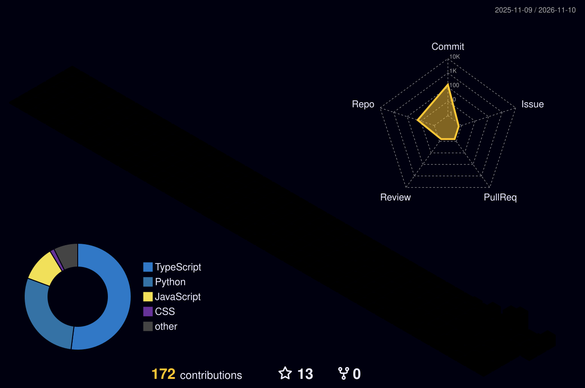

<div align="center">


<a href="https://synaptic-dutta-labs.base44.app">
  
</a>

<br/><br/>


<br/>

[](https://synaptic-dutta-labs.base44.app)
[](mailto:sayantandutta444@gmail.com)
[](https://www.instagram.com/sayantannnnn_)

</div>

---

## 📑 Quick Navigation

[👨‍💻 About](#-about-me) · [🎯 Current Focus](#-current-focus) · [🧠 ML Roadmap](#-ml-learning-roadmap) · [🛠️ Tech Stack](#️-tech-stack) · [🧊 3D Graph](#-my-3d-contribution-graph) · [🚀 Projects](#-featured-projects) · [📊 Stats](#-github-stats) · [🎯 Goals](#-goals) · [🤝 Connect](#-lets-connect)

---

## 👨‍💻 About Me

```python
class Developer:
    name = "Sayantan Dutta"
    location = "Krishnagar, Nadia, West Bengal 🇮🇳"
    education = "B.Tech CSE (AI/ML) Student"
    focus = ["Full Stack Web Development", "Data Analysis with Python", "AI & Machine Learning"]
    completed = ["Mathematics for Machine Learning ✅"]
    currently_learning = ["Machine Learning 🤖", "TypeScript", "Backend architecture"]
    open_to = ["Internships", "Collaborations", "Open-source contributions"]

    def motto(self):
        return "Build in public. Learn every day. Ship often."
```

> 💼 **Professional summary:** CSE (AI/ML) student and full stack developer who builds web applications with the MERN stack, analyzes data with Python, and is now moving into Machine Learning.

<table>
<tr>
<td width="50%" valign="top">

### 🔭 What I do
- 🌐 Build **full-stack web apps** with the MERN stack
- 📊 Analyze data using **Python**
- 🤖 Learn **Machine Learning** step by step
- 🧪 Build small projects to practise every concept

</td>
<td width="50%" valign="top">

### 🌱 What I'm improving
- 🧮 Applying **maths for ML** in real code
- 🟦 Writing cleaner **TypeScript**
- 🏗️ Designing better **backend architecture**
- 📝 Documenting my projects professionally

</td>
</tr>
</table>

<div align="center">

[](https://synaptic-dutta-labs.base44.app)

</div>

---

## 🎯 Current Focus

| Area | Status | What I'm doing |
|---|:---:|---|
| 🤖 **Machine Learning** | 🔄 Learning | Moving from maths foundations to hands-on ML with Python |
| 🌐 **Full Stack (MERN)** | 🔨 Building | Improving existing projects and shipping new ones |
| 🟦 **TypeScript** | 🔄 Learning | Building typed, maintainable projects |
| 🏗️ **Backend** | 🔄 Learning | Practising with the Chai aur Code backend series |
| 📄 **Documentation** | 🔨 Improving | Adding professional READMEs to every repo |

---

## 🧠 ML Learning Roadmap

| Stage | Topic | Status |
|:---:|---|:---:|
| 1 | Maths for ML (linear algebra, calculus, probability & statistics) | ✅ Completed |
| 2 | Python for ML (NumPy, Pandas, Matplotlib) | 🔄 In progress |
| 3 | Supervised learning (regression, classification) | 🎯 Starting |
| 4 | Model evaluation and scikit-learn projects | ⏳ Up next |
| 5 | Unsupervised learning and neural networks | ⏳ Planned |
| 6 | Deep learning and deployed ML projects | ⏳ Planned |

<details>
<summary><b>📚 What each stage covers (click to expand)</b></summary>

<br/>

- **Stage 1: Maths for ML.** Linear algebra, calculus, probability and statistics. *Done.*
- **Stage 2: Python for ML.** Working with arrays, dataframes and plotting data.
- **Stage 3: Supervised learning.** Linear and logistic regression, decision trees, k-NN.
- **Stage 4: Evaluation.** Train/test split, cross-validation, metrics, overfitting, scikit-learn pipelines.
- **Stage 5: Unsupervised and neural nets.** Clustering, dimensionality reduction, first neural networks.
- **Stage 6: Deep learning.** Deeper models, and shipping a deployed ML project.

</details>

---

## 🛠️ Tech Stack

<div align="center">


</div>

<br/>

| 🧩 Area | 🧰 Tools |
|---|---|
| **Languages** | Python · JavaScript · TypeScript · HTML · CSS |
| **Frontend** | React · CSS |
| **Backend** | Node.js · Express |
| **Database** | MongoDB |
| **Data & ML** | Python · NumPy · Pandas · scikit-learn *(learning)* |
| **Tools** | Git · GitHub · VS Code |

<details>
<summary><b>🏅 Skill levels (honest self-assessment)</b></summary>

<br/>

| Skill | Level |
|---|---|
| Python |  |
| JavaScript / React |  |
| Node.js / Express / MongoDB |  |
| TypeScript |  |
| Machine Learning |  |

*Edit these to match your real level.*

</details>

---

## 🧊 My 3D Contribution Graph

<div align="center">



</div>

---

## 🚀 Featured Projects

<table>
<tr>
<td width="50%" valign="top">

### 🤖 [Taskflow-AI](https://github.com/sayantandutta-18/Taskflow-AI)
Full stack **MERN** task management app.


</td>
<td width="50%" valign="top">

### 🛰️ [Mission-Control](https://github.com/sayantandutta-18/Mission-Control)
A **TypeScript** project.


</td>
</tr>
<tr>
<td width="50%" valign="top">

### 📈 [Sales-Data-Analyzer](https://github.com/sayantandutta-18/Sales-Data-Analyzer)
Analyze and summarize sales data with **Python**.


</td>
<td width="50%" valign="top">

### 🎓 [Student-Performance-Analyzer](https://github.com/sayantandutta-18/Student-Performance-Analyzer)
Student performance analysis built in **Python**.


</td>
</tr>
<tr>
<td width="50%" valign="top">

### 🌐 [Portfolio](https://synaptic-dutta-labs.base44.app)
My personal portfolio, built with **Base44**. [Live site](https://synaptic-dutta-labs.base44.app) · [Older version on GitHub](https://github.com/sayantandutta-18/Portfolio)


</td>
<td width="50%" valign="top">

### 🏥 MediChain · 🛡️ ScamRadar
More projects, featured on my [portfolio](https://synaptic-dutta-labs.base44.app).


</td>
</tr>
<tr>
<td colspan="2" valign="top">

### ☕ [chaiaurbackend](https://github.com/sayantandutta-18/chaiaurbackend)
Backend development practice following the *Chai aur Code* video series.


</td>
</tr>
</table>

> 📌 **More coming soon:** ML projects will be added here as I progress through my Machine Learning roadmap.

---

## 📊 GitHub Stats

<div align="center">


<br/>


<br/>


</div>

---

## 🏆 Achievements

<div align="center">


</div>

---

## 🎯 Goals

- [x] Complete **Mathematics for Machine Learning**
- [x] Build a personal **portfolio website**
- [x] Create a professional **GitHub profile**
- [ ] Learn **Python for ML** (NumPy, Pandas, Matplotlib)
- [ ] Finish the core **supervised learning** algorithms
- [ ] Build and publish my **first ML project**
- [ ] Add professional READMEs to **all my repositories**
- [ ] Get an **internship** in software or AI/ML
- [ ] Contribute to an **open-source** project

---

## 🤝 Let's Connect

<div align="center">

[](https://synaptic-dutta-labs.base44.app)
[](mailto:sayantandutta444@gmail.com)
[](https://www.linkedin.com/in/YOUR-LINKEDIN-ID)
[](https://www.instagram.com/sayantannnnn_)
[](https://github.com/sayantandutta-18)

<br/>

### 💬 *"Build in public. Learn every day. Ship often."*

<br/>

⭐ *If you like what you see, drop a star on any repo!* ⭐


</div>
